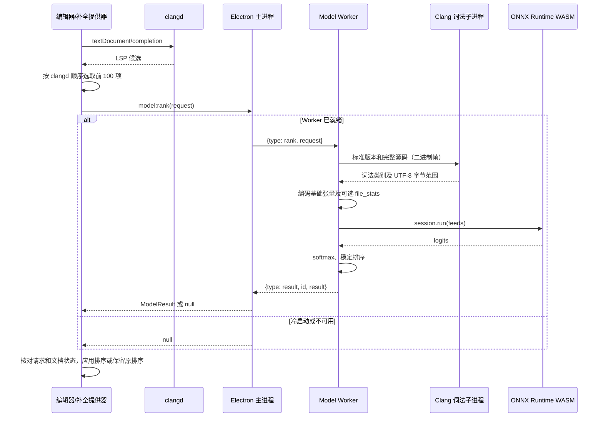

# ITER 补全模型调用协议

本文覆盖部署模型的基础张量契约及可选 `file_stats` 输入；具体模型版本与来源以 [部署清单](../resources/model/manifest.json) 为准。

本文描述当前源码的实际行为，供替换、重新训练或实现兼容排序模型使用。应用接口对象、Worker 消息和 ONNX 张量是三个不同层次，不能互相替代。本文中的 JSON 响应示例只展示结构，示例概率不是模型效果承诺。

## 1. 功能与边界

在“设置 → 补全 → Model”开启，默认关闭；设置键为 `editor.completion.model`。还需要启用语义补全并让 clangd 正常工作。

模型为 clangd 已返回的候选评分并重排。候选生成、语义分析、插入文本、替换范围、附加编辑和函数括号光标行为仍由 clangd 及现有补全流程负责。模型不生成新候选、不续写源码，也不决定输入几个字符才弹出列表；触发阈值仍由现有补全设置和策略控制。

当前运行环境是 Electron 主进程管理的 Node Worker，使用 ONNX Runtime Web 1.22.0 的 WASM CPU 后端，单线程，无需 Python、PyTorch、CUDA 或网络服务。应用没有为此功能提供 HTTP 地址或 TCP 端口。

## 2. 一次请求如何完成



渲染器先检查补全场景、最少字符、策略抑制和语义补全状态，再请求模型。候选少于 2 个，或当前显示候选里没有可评分的语义项时，不调用 Model。主进程接口本身接受 1～100 个候选。

当前源码会先按 `sortText` 选择模型候选：两项都有 `sortText` 时按字符串升序比较，相等则按原下标；有项缺少 `sortText` 时该次比较按原下标。clangd 正常返回的 `sortText` 应保留，不要在送入模型前改成用户常用项排序。

## 3. 应用请求接口

### 3.1 方法和通道

```ts
window.iter.model.warmup(): Promise<void>
window.iter.model.rank(request: ModelRequest): Promise<ModelResult | null>
window.iter.model.cancel(id: string): void
```

| 方法            | Electron 通道  | 传输方式             | 含义                                   |
| --------------- | -------------- | -------------------- | -------------------------------------- |
| `warmup()`      | `model:warmup` | `ipcRenderer.invoke` | 请求后台准备资源；返回不代表模型已就绪 |
| `rank(request)` | `model:rank`   | `ipcRenderer.invoke` | 请求排序，等待结果或回退               |
| `cancel(id)`    | `model:cancel` | `ipcRenderer.send`   | 取消对应调用，没有返回确认             |

主进程只接受当前主窗口 `webContents` 发来的 Model 调用。这些 API 是 ITER 渲染器接口，不是任意外部进程可直接调用的服务。

### 3.2 TypeScript 定义

```ts
interface ModelCandidate {
  label: string;
  kind?: number;
  filterText?: string;
  detail?: string;
  labelDetails?: { detail?: string };
  score?: number;
}

interface ModelRequest {
  id: string;
  source: string;
  cursor: number;
  prefix: string;
  standard: string;
  candidates: ModelCandidate[];
}

interface ModelResult {
  order: number[];
  probabilities: number[];
}
```

### 3.3 字段含义和当前校验

所有字符串长度上限若未特别说明，均使用 JavaScript `string.length`，单位是 UTF-16 码元。

| 字段                  | 必填 | 当前要求和含义                                                                                                      |
| --------------------- | ---- | ------------------------------------------------------------------------------------------------------------------- |
| `id`                  | 是   | 字符串，最多 128 码元；调用方应生成唯一、非空 ID。当前校验允许空串，不应依赖这一点                                  |
| `source`              | 是   | 当前文档的完整字符串，包含未保存修改；不得含 NUL；入口最多 262,144 码元，词法桥另限制 UTF-8 编码后最多 262,144 字节 |
| `cursor`              | 是   | 整数，`0 <= cursor <= source.length`；是从 0 开始的 UTF-16 偏移，不是行列或 UTF-8 字节偏移                          |
| `prefix`              | 是   | 已输入前缀，最多 512 码元；允许空串；调用方负责使其与光标位置一致                                                   |
| `standard`            | 是   | `c++98/11/14/17/20/23/26` 或对应 `gnu++` 形式，例如 `gnu++17`                                                       |
| `candidates`          | 是   | 1～100 项，数组顺序就是原候选排名                                                                                   |
| `label`               | 是   | 候选显示文本，最多 4,096 码元；当前校验允许空串                                                                     |
| `kind`                | 否   | 整数 0～25，通常为原始 LSP CompletionItemKind；缺失编码为 0                                                         |
| `filterText`          | 否   | 字符串，最多 4,096 码元；用于名称提取，空串会回退到 `label`                                                         |
| `detail`              | 否   | 字符串，最多 8,192 码元；保留原描述文字                                                                             |
| `labelDetails.detail` | 否   | 字符串，最多 4,096 码元                                                                                             |
| `score`               | 否   | 有限数值；缺失按 0 处理，不接受 NaN、Infinity 或 null                                                               |

可选字段缺失时应省略，不要用 `null` 代替。当前验证器不拒绝额外字段，但它们不自动成为模型输入。现有渲染器通过对象展开还会携带 `flags`；它用于提取 `standard`，不进入 ONNX 张量。`labelDetails.description` 也不参与当前特征编码。

`standard` 从编译参数中匹配 `-std=c++...` 或 `-std=gnu++...` 的上述数字形式；未匹配到时使用 `gnu++17`。例如 `-std=c++2a` 当前会走默认值，接口不会自动把别名转成 `c++20`。

### 3.4 光标示例

```js
const source = "int damageMultiplier; int main(){ return dam; }";
const cursor = source.indexOf("dam;") + 3;

const request = {
  id: "manual-completion-1",
  source,
  cursor,
  prefix: "dam",
  standard: "gnu++17",
  candidates: [
    { label: "damageCount", kind: 6, detail: "int" },
    { label: "damageMultiplier", kind: 6, detail: "int" }
  ]
};

const result = await window.iter.model.rank(request);
```

对中文和 emoji 同样使用 Monaco/JavaScript 的 UTF-16 偏移。例如 emoji 通常占 2 个 UTF-16 码元。进入编码器后，按下式转换为词法桥使用的 UTF-8 偏移：

```ts
const cursorBytes = Buffer.byteLength(source.slice(0, cursor), 'utf8');
```

## 4. 返回格式

```json
{
  "order": [1, 0],
  "probabilities": [0.15, 0.85]
}
```

- `order[j]`：第 `j` 名候选在请求数组中的原下标，从 0 开始。
- `probabilities[i]`：请求数组第 `i` 项的概率，始终按原数组索引，不按新排名排列。
- `null`：本次不用模型结果，保留原排序；不表示空补全列表。

给定 K 个候选，`order` 必须长度为 K、包含且仅包含 `0..K-1` 各一次。`probabilities` 必须长度为 K，每项有限且在 `[0,1]` 内，概率之和与 1 的绝对差严格小于 `0.0001`。

当前结果校验器只检查上述结构，不重新验证顺序与概率的对应关系；替代实现必须自己保证一致。现有 Worker 使用同一组 logits 同时生成两个数组，相同分数按原下标升序，排序稳定。

这些概率是当前候选集合内 softmax 的相对概率，不代表已经校准的“补全正确率”，也不包含“所有候选都不对”的额外类别。

## 5. 主进程与 Worker 消息

Worker 创建时的 `workerData`：

```ts
{
  assets: string;   // 补全模型资源目录绝对路径
  library: string;  // 内置 libclang.dll 的绝对路径
  scratch: string;  // 本实例词法临时目录绝对路径
}
```

主进程发送：

```ts
{ type: 'rank', request: ModelRequest }
{ type: 'dispose' }
```

Worker 返回：

```ts
{ type: 'helper', pid: number }  // 已创建的本实例词法子进程
{ type: 'ready' }               // ONNX session 和词法桥均已准备好
{ type: 'result', id: string, result: ModelResult | null }
{ type: 'unavailable' }         // 初始化或执行失败
```

一次执行出错时，Worker 可先返回对应 ID 的 `result: null`，再发送 `unavailable`。主进程据此清理 Worker，后续新请求在退避时间结束后才尝试重新准备。

Worker 内按消息到达顺序执行任务，`dispose` 排在已接收任务后释放 session、关闭词法子进程和消息端口。主进程以代次编号屏蔽旧 Worker 的迟到消息。

## 6. 词法桥二进制协议

这部分连接 Model Worker 和 `tokenizer.exe`，使用子进程 stdin/stdout。所有 32 位整数均为无符号、小端序。stderr 不参与协议，普通日志不能混进 stdout。

### 6.1 启动参数

```text
tokenizer.exe <libclang.dll绝对路径> <临时lex.cpp绝对路径> <所属主进程PID>
```

词法桥使用 `LoadLibraryExW` 加载指定库，版本须匹配 `clang version 19.1.7`。解析使用当前源码的内存缓冲区；`lex.cpp` 是临时路径占位文件，源码不由这条桥写入该文件。`TEMP`、`TMP` 指向 scratch。

Clang 参数为 `-x c++`、`-std=<standard>`、`-fno-modules`、`-fno-implicit-modules`；translation unit flags 为 `0x600`，采用与训练器一致的单文件模式，不加载所包含头文件的内容。

### 6.2 通用帧

```text
uint32_le payloadLength
byte[payloadLength] payload
```

输出帧长度和累积缓冲区上限均为 4 MiB；payload 长度至少为 1。启动握手超时 5,000ms，单次词法请求超时 800ms。

### 6.3 Worker → 词法桥请求 payload

```text
uint32_le standardByteLength
byte[standardByteLength] standardUtf8
byte[剩余长度] sourceUtf8
```

请求没有操作码。源码 UTF-8 上限 256 KiB；桥允许的总 payload 上限为 `256 KiB + 32`，标准版本字符串长度上限为 16 字节。实际合法版本集合仍以应用层校验为准。

### 6.4 词法桥 → Worker 响应 payload

| 首字节 | 后续内容                               | 含义     |
| ------ | -------------------------------------- | -------- |
| `0x02` | UTF-8 版本字符串                       | 启动握手 |
| `0x00` | `uint32_le count`，随后 count 个 token | 词法成功 |
| `0x01` | UTF-8 错误文字                         | 词法错误 |

每个 token 固定 9 字节：

```text
uint8 kind
uint32_le start
uint32_le end
```

`start/end` 为完整源码 UTF-8 缓冲区中的半开范围 `[start,end)`。Worker 检查 `0 <= kind <= 4`、`start < end <= 源码字节数`，以及 payload 总长是否恰为 `5 + count*9`。

| 原始 CXTokenKind | 含义   |
| ---------------- | ------ |
| 0                | 标点   |
| 1                | 关键字 |
| 2                | 标识符 |
| 3                | 字面量 |
| 4                | 注释   |

桥是实际的 Clang 词法接口；模型后续使用 UTF-8 字节表示拼写，没有一张固定的变量名词表。`damageMultiplier` 等未见过的名称仍能编码，但这不保证任何未知名称都能被正确排到第一。

## 7. 上下文编码

给定原始 token 列表和转换后的 `cursorBytes`：

1. 移除 `kind === 4` 的注释。
2. 左侧取 `end <= cursorBytes` 的最后 128 项。
3. 右侧取 `start >= cursorBytes` 的最前 32 项。
4. 中间放入一个光标单元，其内部 kind 为 5，文本为 `<cursor>`。
5. 按“左侧、光标、右侧”顺序从张量索引 0 起存放，剩余位置在末尾补零到 192。

最多有 161 个有效上下文单元。这里不是固定把光标放在索引 128，也不是在左侧补零。跨越光标边界的单个 token 不放入两侧；如果当前已输入前缀的 token 恰好结束于光标，则仍会出现在左侧。

字面量统一以 `<literal>` 编码；其他单元使用 Clang 给出的原始 UTF-8 拼写。词法类别编码为 `kind + 1`：

| context_kinds 值 | 含义                                         |
| ---------------- | -------------------------------------------- |
| 0                | 填充                                         |
| 1                | 标点                                         |
| 2                | 关键字                                       |
| 3                | 标识符                                       |
| 4                | 字面量                                       |
| 5                | 注释对应的偏移值；正常输入已移除注释，不使用 |
| 6                | 光标                                         |

每个上下文单元最多取前 48 个 UTF-8 字节，每字节 `b` 存为 `b + 1`，未使用位置为 0。截断以字节为单位，可截在多字节字符内部；模型直接读取字节编号。

## 8. 候选编码及 8 项数值特征

### 8.1 名称提取

当前实现的精确逻辑：

```ts
function candidateName(item: ModelCandidate): string {
  const text = (item.filterText || item.label).trim();
  if (item.kind === 17 || item.kind === 19) {
    return text.replace(/[>"/]+$/, '');
  }
  return text.split('(', 1)[0]
    .split('<', 1)[0]
    .trim()
    .split('::').at(-1) ?? '';
}
```

这里的 LSP kind 17 为 File，19 为 Folder。文件分支不会取 basename，例如 `path/header.h>` 得到 `path/header.h`。这是一套固定字符串规则，不是对候选重新执行 C++ 语义解析。例如 `ns::query(int x)` 编成名称 `query`，文件类候选 `stdc++.h>` 编成 `stdc++.h`。LSP 的显示文本本来就不要求等于一个 C++ 词法 token。

### 8.2 候选字节与类别

候选编码文字严格为：

```text
名称 + "\n" + (labelDetails.detail 或空串) + "\n" + (detail 或空串)
```

即使描述为空，两个换行仍然保留。UTF-8 编码后取前 256 字节，每字节加 1，末尾补零。`candidate_kinds` 直接使用原始 LSP `kind`，缺失为 0；这里不加 1，也不改成 CXTokenKind。

例如 `label="ns::query(int x)"`、`detail="long long"`、没有 `labelDetails.detail`，编码文字为 `query\n\nlong long`。首个字符 `q` 的 ASCII 字节为 113，模型输入为 114。

### 8.3 features 的固定顺序

设 `i` 是请求内从 0 开始的候选下标，`s = score ?? 0`，`name` 是提取后的名称：

| 索引 | 数值                                                  |
| ---- | ----------------------------------------------------- |
| 0    | `1 / (i + 1)`                                         |
| 1    | `s / (1 + abs(s))`                                    |
| 2    | `min(codePointLength(prefix), 64) / 64`               |
| 3    | `min(codePointLength(name), 128) / 128`               |
| 4    | `Number(name.startsWith(prefix))`                     |
| 5    | `Number(casefold(name).startsWith(casefold(prefix)))` |
| 6    | `Number(casefold(name).includes(casefold(prefix)))`   |
| 7    | `Number(name === prefix)`                             |

特征长度使用 Unicode 码点数，区别于请求校验中的 UTF-16 长度。结果按上述顺序写入 Float32Array。布尔值为 0 或 1。

`casefold` 逐码点执行：优先使用 `casefold.generated.json` 中的补充映射，否则使用 JavaScript `toLowerCase()`；补充表基于 Python 3.12 / Unicode 15.0。它不等于仅对 ASCII 转小写，也不是 localeCompare。

## 9. ONNX 输入输出契约

### 9.1 输入

应用每次只送一条请求，batch 恒为 1，K 为实际候选数量。没有将候选补齐到 100。

| 名称              | ONNX 类型 | 形状         | JavaScript 容器          |
| ----------------- | --------- | ------------ | ------------------------ |
| `context_bytes`   | int64     | `[1,192,48]` | BigInt64Array            |
| `context_kinds`   | int64     | `[1,192]`    | BigInt64Array            |
| `candidate_bytes` | int64     | `[1,K,256]`  | BigInt64Array            |
| `candidate_kinds` | int64     | `[1,K]`      | BigInt64Array            |
| `features`        | float32   | `[1,K,8]`    | Float32Array             |
| `candidate_mask`  | bool      | `[1,K]`      | Uint8Array，当前全部为 1 |

### 9.1.1 可选输入 `file_stats`

当前随包模型（PtrRank）多声明一个输入：`file_stats`，`float32`，形状 `[1,K,8]`，按候选下标对齐。特征层统一生成这些统计；Worker 创建 session 后检查 `session.inputNames`，只有模型声明了它才传入，所以不带它的模型照常可用。定义（注释和字面量不计，正在输入的词不计，距离单位是 token）：

| 索引 | 含义                                                                                                             |
| ---- | ---------------------------------------------------------------------------------------------------------------- |
| 0    | `log1p(全文出现次数) / 5`                                                                                        |
| 1    | `log1p(光标左侧出现次数) / 5`                                                                                    |
| 2    | `1 / (1 + 光标左侧最近一次出现与光标的 token 距离)`，没有则 0                                                    |
| 3    | `1 / (1 + 光标右侧最近一次出现与光标的 token 距离)`，没有则 0                                                    |
| 4    | 有出现位置落在 161 个 token 窗口之外则为 1                                                                       |
| 5    | 左侧第一次出现像声明则为 1（前一个 token 是关键字、标识符或 `>` `&` `*` `&&`，后一个是 `=` `;` `,` `(` `[` `{`） |
| 6, 7 | 保留，恒为 0                                                                                                     |

实现与黄金样本：`src/main/model/features.ts` 的 `fileStats`，训练器侧是 `file_stats.py`，两边逐字节对齐。

所有张量按行优先布局展开。例如 `candidate_bytes[0,i,j]` 在一维数组中的位置是 `i*256+j`。布尔张量类型仍须声明为 `bool`，不能因为其容器为 Uint8Array 就改成 ONNX uint8。

### 9.2 输出

```text
输出名：logits
类型：float32
形状：[1,K]
含义：每个原候选的未归一化分数
```

输出应恰有 K 个有限分数，不应包含 NaN 或正负 Infinity。应用当前直接读取 `logits.data`，不会为错误形状补齐或裁剪；主进程的最终结果校验会拒绝数量不符的返回。当前实现没有显式核验输出张量的 dtype/dims，因此错误形状但元素数恰为 K 的输出可能通过数量检查；替代模型仍须遵守本契约，验证时应单独检查真实输出元数据。

Worker 计算：

```ts
const m = Math.max(...logits);
const weights = logits.map(x => Math.exp(x - m));
const total = weights.reduce((a, b) => a + b, 0);
const probabilities = weights.map(x => x / total);
const order = logits.map((_, i) => i)
  .sort((a, b) => logits[b] - logits[a] || a - b);
```

替代 ONNX 模型应输出 logits；若输出的已经是概率，ITER 仍会再次做 softmax，概率语义将发生变化。

现有模型导出采用 ONNX opset 17，batch 及候选数动态，其余上述维度固定。替代模型的算子还必须能在随包携带的 ORT WASM CPU 后端运行；仅在 Python/桌面 GPU 后端运行成功不足以确认可直接替换。模型内部架构和参数量可以变化，只要保持本契约及延迟要求。

## 10. 超时、队列和生命周期

| 项目                | 当前值或行为                                                     |
| ------------------- | ---------------------------------------------------------------- |
| 单请求等待预算      | 主进程 120ms，从排入请求队列时开始，包含等待前一个请求的时间     |
| 渲染器保护预算      | 140ms，即主进程预算加 20ms；超时会发送 cancel 并保留原排序       |
| 排队                | 最多一个运行中请求、一个等待请求；新等待请求替换旧等待请求       |
| 重复 ID             | 与当前运行/等待请求重复时返回 null，不重复执行                   |
| 冷启动              | 本次请求立即返回 null，同时后台初始化；不会等待 ready 再返回     |
| Worker 初始化上限   | 6,000ms                                                          |
| 词法桥握手/词法请求 | 5,000ms / 800ms                                                  |
| 执行看门狗          | 从发给 Worker 开始 1,000ms，届时仍未完成则回收 Worker            |
| 故障重试退避        | 3,000ms；退避后由后续准备/请求触发重试，没有持续重试循环         |
| 正常清理            | 发 dispose，让 session 释放；最多等待 1,000ms，随后强制回收      |
| Worker JS 堆限制    | 老生代 128MiB，新生代 16MiB；这不是全部 WASM/native 内存的硬上限 |
| 词法桥进程内存      | Windows Job 限制为 512MiB，低于正常进程优先级                    |

`cancel` 或 120ms 超时只让调用者尽快得到 null，并移除尚未执行的等待任务。已经运行的词法/ONNX 操作不会被逐指令中断；它仍占用 active 槽，直到返回或被 1,000ms 看门狗回收。不能把“已取消”等同于“CPU 此刻已经停止”。

关闭 Model、关闭窗口或故障清理只处理本服务创建的 Worker 和词法子进程。快速关闭/重开时，旧 Worker 的清理任务也会纳入最终退出等待；词法桥另外监测所属主进程存活。

冷启动 ready 后不会主动替当前已经显示的列表补发排序，要在后续补全请求中使用模型。`warmup()` 只发起准备，不是 ready 的等待接口。

## 11. 如何把模型顺序应用到补全列表

模型评分使用的是 clangd 原顺序；展示前仍经过 ITER 原有候选过滤与排序。Model 只重排其中“来自本次前 100 项且能对应原 LSP 对象”的语义候选槽位。

例如原展示列表为 `[片段, A, 本地项, B]`，模型把 B 排到 A 前，结果为 `[片段, B, 本地项, A]`。显式片段、本地补充项和未被模型评分的项保留其位置。

Model 不覆盖 `textEdit`、`additionalTextEdits`、snippet 或括号规则。成功结果还必须通过文档版本、model 身份、补全请求序号及取消状态检查；旧请求即使源码版本未变，也不能覆盖较新的补全请求。等待期间关闭 Model 则恢复原排序。

因此“模型给出的概率顺序”与“最终列表整体顺序”不是在所有情况下都完全相同，Monaco 的筛选行为也仍然存在。

## 12. 资源位置和 manifest

开发资源位于仓库的 `app/resources/model/`；安装版本位于应用安装目录的 `resources/model/`。不要依赖某个开发者的绝对路径。

```text
model/
  ranker.onnx
  manifest.json
  tokenizer.exe
  runtime/
    ort.wasm.min.js
    ort-wasm-simd-threaded.mjs
    ort-wasm-simd-threaded.wasm
    LICENSE.txt
    ThirdPartyNotices.txt
```

源码目录另外保存 `tokenizer.cpp`。libclang 位于上一级 `resources\toolchain\bin\libclang.dll`。Worker 本体由构建产出 `out/main/model-worker.js`，打包在 app.asar 中。

以下是字段结构示意；哈希占位符不可作为实际清单使用：

```json
{
  "schema": 1,
  "model": "ranker.onnx",
  "tokenizerVersion": "19.1.7",
  "features": {
    "context_tokens": 192,
    "token_bytes": 48,
    "candidate_bytes": 256
  },
  "checkpoint_sha256": "<训练检查点 SHA-256>",
  "onnxruntime": "1.22.0",
  "unicodeVersion": "15.0.0",
  "assets": {
    "ranker.onnx": "<小写 SHA-256>",
    "tokenizer.exe": "<小写 SHA-256>",
    "runtime/ort.wasm.min.js": "<小写 SHA-256>",
    "runtime/ort-wasm-simd-threaded.mjs": "<小写 SHA-256>",
    "runtime/ort-wasm-simd-threaded.wasm": "<小写 SHA-256>",
    "runtime/LICENSE.txt": "<小写 SHA-256>",
    "runtime/ThirdPartyNotices.txt": "<小写 SHA-256>"
  }
}
```

当前运行时强制检查 `schema === 1`、`tokenizerVersion === '19.1.7'`，并逐项验证 `assets` 中记录的文件 SHA-256。哈希比较区分大小写，生成时应转小写。

`model`、`features`、`onnxruntime`、`unicodeVersion`、`checkpoint_sha256` 当前用于记录，不会自动改变加载文件名、输入尺寸、字节规则或运行时版本。模型文件名仍硬编码为 `ranker.onnx`，输入尺寸仍由 Worker/编码器固定。改变特征契约需要同步修改应用及训练器、重新验证。

应用包的清单与训练器导出目录的清单结构不同：训练器导出清单含顶层 `sha256` 和 `inputs`；ITER 部署清单含 `assets` 和 `tokenizerVersion`。不能直接用训练器清单覆盖应用清单；应保留部署清单，更新其中模型哈希和来源记录。

模型的训练来源记录、检查点 SHA-256 和 ONNX SHA-256 保存在 [部署清单](../resources/model/manifest.json)。更换模型时同步更新这些字段，避免在文档中重复维护过期的版本信息。

## 13. 更换或重新训练模型

1. 使用与第 7～9 节完全一致的特征处理训练，尤其保持候选原排名、名称提取、Unicode casefold 和字节加 1 规则一致。
2. 将检查点导出为 ONNX，输入名、类型、维度及 `logits` 输出符合本协议；候选维度支持变化。
3. 在独立副本中比较训练框架与 ONNX 的输出，随后使用实际随包 WASM Runtime 验证；覆盖不同 K、中文/emoji、文件候选、自定义名称及快速取消。
4. 关闭 ITER，单独保留旧 `ranker.onnx` 与部署 `manifest.json`，然后替换模型。保留原分词桥和运行资源，除非本次明确同步升级这些组件。
5. 更新部署清单里的 `assets['ranker.onnx']`，并更新模型来源记录。重新启动 ITER 并开启 Model。
6. 若需要恢复，关闭 ITER 后将旧模型与其配套清单一起恢复，再启动。

更新已替换模型的哈希示例（只修改部署清单，不执行训练）：

```powershell
# 在仓库的 app/ 目录运行；修改安装版本时改为其实际资源路径。
$model = Join-Path $PWD 'resources/model'
$modelFile = Join-Path $model 'ranker.onnx'
$manifestFile = Join-Path $model 'manifest.json'
$manifest = Get-Content -LiteralPath $manifestFile -Raw -Encoding UTF8 | ConvertFrom-Json
$manifest.assets.'ranker.onnx' = (Get-FileHash -LiteralPath $modelFile -Algorithm SHA256).Hash.ToLowerInvariant()
$json = ($manifest | ConvertTo-Json -Depth 12) + [Environment]::NewLine
[IO.File]::WriteAllText($manifestFile, $json, [Text.UTF8Encoding]::new($false))
```

`.pt` 不能作为 ONNX 文件直接加载。模型内部可以换成其他结构，但新模型仍需消费同样的六个基础张量及其声明的可选 `file_stats`、返回同样的 logits，并适配现有 CPU 预算。只换模型时不必新增词表文件，也不能假设将新字段加进 JSON 就能成为 ONNX 输入。

正式发行应同时更新源码中的资源与清单，再构建新安装包。只手动替换安装目录的模型，后续应用升级可能将其覆盖。

## 14. 验证方法和固定样本

`npm test` 为每次运行和每个测试文件创建独立数据目录，隔离题库、临时文件和用户 profile。真实模型集成测试默认关闭，避免每次普通检查都加载原生工具链和 WASM 模型。

| 文件                          | 验证内容                                                          |
| ----------------------------- | ----------------------------------------------------------------- |
| `features.test.ts`            | 基础输入数组的固定哈希、文件统计特征和概率结构                    |
| `golden-fixtures.json`        | 固定请求、真实 Clang token 范围、基础输入哈希、参考 logits 与顺序 |
| `runtime.integration.test.ts` | 真实词法桥、Node Worker、随包 ORT WASM 推理                       |
| `service.test.ts`             | 冷启动、队列覆盖、重复 ID、超时、清理与快速开关                   |
| `renderer/lang/model.test.ts` | 展示重排、原编辑文本、括号光标、迟到结果及关闭开关                |

首次验证前在 `app/` 运行 `npm ci` 和 `npm run setup`，准备依赖及原生 helper。修改模型或词法桥后，可执行以下专项验证：

```powershell
npm run build
$previousModelIntegration = $env:ITER_TEST_MODEL_INTEGRATION
try {
    $env:ITER_TEST_MODEL_INTEGRATION = '1'
    npm test -- src/main/model src/renderer/lang/model.test.ts
    if ($LASTEXITCODE -ne 0) { throw '模型集成验证失败' }
} finally {
    $env:ITER_TEST_MODEL_INTEGRATION = $previousModelIntegration
}
```

构建先于真实 Worker 集成测试，因为它读取 `out/main/model-worker.js`。集成测试概率误差断言为绝对差小于 `0.0001`，并要求排序相同；特征测试则要求输入字节哈希完全一致。

需要完整物理副本时，可使用 [verify-isolated.ps1](../scripts/verify-isolated.ps1)。这个可选脚本会复制依赖和工具链，成本较高；常规源码检查使用默认隔离测试即可。

### 14.1 新权重的参考输出

当前仓库提供推理资源、协议和回归夹具，不包含完整训练器、训练语料或训练检查点。重新训练需要自行准备相应资源，并遵守本协议的编码与输入约定。

更换权重会改变预测。应保留请求、Clang token 和输入哈希基准，用训练框架加载新权重生成参考 logits，再与实际 ONNX Runtime WASM 输出比较。建议要求最大绝对误差不超过 `1e-4`、排序一致，并覆盖动态候选维度；不要为绕过输入错误重写全部基准。

若修改词法桥，执行 `npm run build-model-tokenizer`。脚本使用内置 MinGW 生成静态 EXE，并更新部署清单的 tokenizer 哈希。Windows 安装包构建也会执行此步骤。

## 15. 故障排查

| 现象                               | 核对项                                                                             |
| ---------------------------------- | ---------------------------------------------------------------------------------- |
| 开关刚打开时仍是原排序             | 冷启动正常回退；warmup 不等待 ready，后续请求才会使用模型                          |
| 只返回 null                        | 开关、语义补全状态、初始化、ID 是否重复、请求字段和预算                            |
| 提示“Model 加载失败，已使用原排序” | 部署清单、七项资源哈希、libclang 版本、路径、WASM 运行支持；下一次重试需等退避结束 |
| 有模型结果但整个列表顺序不同       | 只有评分范围内的语义槽位重排，片段/本地项保持位置，还受 Monaco 筛选影响            |
| 自定义名称表现差                   | 检查 UTF-8、filterText、候选上下文和训练分布；未知拼写可编码不等于预测一定正确     |
| 取消后 CPU 短时间仍在工作          | active 计算会完成或由看门狗回收，取消先结束调用者等待                              |
| 更换模型后全部回退                 | 检查真实张量名、int64/bool 类型、动态 K、有限 logits、哈希和 WASM 算子兼容性       |
| 改 manifest 的尺寸没有生效         | 尺寸当前在应用中固定，manifest 不负责动态配置编码器                                |

## 16. 源码入口

以下链接指向仓库内的实现，供协议维护时核对。

| 职责                     | 文件                                                                 |
| ------------------------ | -------------------------------------------------------------------- |
| 请求、返回类型与校验     | [shared/model.ts](../src/shared/model.ts)                            |
| 渲染器 API               | [preload/index.ts](../src/preload/index.ts)                          |
| IPC、资源路径和开关门控  | [main/ipc.ts](../src/main/ipc.ts)                                    |
| 候选选择和局部重排       | [renderer/lang/model.ts](../src/renderer/lang/model.ts)              |
| 文档/请求过期检查        | [renderer/lang/index.ts](../src/renderer/lang/index.ts)              |
| 主进程队列与生命周期     | [main/model/service.ts](../src/main/model/service.ts)                |
| ORT 加载、模型张量和消息 | [main/model/worker.ts](../src/main/model/worker.ts)                  |
| 名称、字节和数值特征     | [main/model/features.ts](../src/main/model/features.ts)              |
| Unicode casefold 补充表  | [casefold.generated.json](../src/main/model/casefold.generated.json) |
| 词法桥宿主和帧解码       | [main/model/tokenizer.ts](../src/main/model/tokenizer.ts)            |
| 原生 Clang C API 桥      | [tokenizer.cpp](../resources/model/tokenizer.cpp)                    |
| 部署资源清单             | [manifest.json](../resources/model/manifest.json)                    |
| 固定互操作样本           | [golden-fixtures.json](../src/main/model/golden-fixtures.json)       |
| 运行资源打包             | [electron-builder.yml](../electron-builder.yml)                      |
